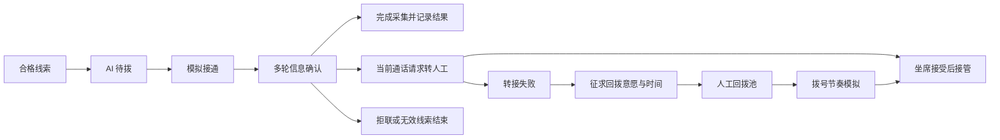

# DriveReach AI：二手车卖车线索智能外呼协同台

日期：2026-11-19  
阶段：产品设计草案。用户已选择「可运行核心流程 + 产品案例说明」；尚未开发、接入电话线路、完成用户访谈或取得评测结果。

## 1. 项目定位与事实边界

一句话：帮助外呼运营通过 AI 确认卖车线索的有效性、出售意愿和车辆信息，并把需要深度沟通的客户交给人工坐席，留下可追溯的处理记录。

来源是用户提供的两张招聘截图。可以设计一个对齐 JD 能力要求的个人项目；无法仅凭 JD 还原该公司的内部系统、业务规则或实际经营数据。截图中的「C1」保留为业务原词，不推断其内部定义。

| 信息类别 | 内容 |
| --- | --- |
| JD 明确要求 | 二手车卖车线索清洗、多轮对话、话术与意图、车辆信息采集、线路管理、并发调度、监控预警、AI 与预测式外呼协同、SQL 分析 |
| 本项目的设计假设 | 已有获准联系的卖车线索；运营负责批次与规则；坐席负责深度沟通；首版使用虚构数据 |
| 待访谈验证 | 合格线索标准、必采字段、意向分层、回拨规则、坐席接管方式、最不可接受的错误 |
| 当前没有的证据 | 真实业务基线、真实用户使用效果、线上转化或成本收益、电话语音效果 |

「线索清洗」包括两层：导入时的数据去重和校验，以及对话中对卖车意愿、信息真实性与后续跟进条件的确认。字段齐全不等于线索有效。

## 2. 作品集需要证明的能力

| JD 要求 | 要做出的产品行为 | 可展示证据 |
| --- | --- | --- |
| 产品规划与重构 | 一条端到端处理流程，明确角色和系统边界 | 现状假设、目标流程、范围取舍、状态图 |
| 多轮对话与采集 | 已知的不重复问；不确定的追问；改口可更正 | 对话记录、字段证据、失败案例 |
| 异常兜底 | 报价转人工；明确拒联停止；工具失败可恢复 | 路由决策记录、错误状态、验收用例 |
| 线路与并发 | 有限线路容量、拨打队列、重试与熔断 | 模拟负载变化、任务事件日志 |
| AI 与人工协同 | 区分当前通话转接和结束后的人工回拨 | 转接状态、回拨任务、上下文摘要 |
| 预测式外呼 | 根据坐席容量和接通概率调整人工外呼节奏 | 独立调度模拟、利用率与接通后无人承接情况 |
| 数据驱动迭代 | 明确分母、版本和样本，再比较效果 | SQL、评测报告、Bad Case 到修复的证据链 |

## 3. 用户、任务与范围

主要用户：外呼运营，负责批次配置、结果查看与异常处理。  
次要用户：人工坐席，负责接管高意向或复杂沟通。  
质量评审者：主管或有相关经验的业务人员，审核字段、意图和路由结果。

首版任务：对一批已获准联系的虚构卖车线索，完成首次触达、信息确认、分流与结果记录。

### 三层实现边界

| 层级 | 实际实现内容 | 对外展示方式 |
| --- | --- | --- |
| 核心闭环 | 模型 API 多轮处理、结构化抽取、证据引用、规则路由、数据写入、失败恢复、事件指标 | 可运行功能；保留真实请求耗时和调用结果 |
| 运行环境 | 电话接通/忙线/失败事件、线路容量、坐席状态、拨号节奏 | 所有相关页面标注「模拟线路 / 模拟坐席」 |
| 后续扩展 | 流式 ASR/TTS、打断、真实电话桥接、运营商接入、生产权限与部署 | 路线图，不列为已完成能力 |

第一版采用文本模拟电话交互，以便优先验证对话和业务处理。实际 ASR、语音自然度、端到端语音延迟与生产规模稳定性，需要独立的音频链路和测试，不能由文本 Demo 推导。

模型未配置时可进入「固定案例回放」模式，并明确标注；模型失败时显示失败，不自动以回放结果冒充实时生成。

## 4. 一条主流程与三条重点异常

主流程：导入线索 → 校验触达资格 → 加入 AI 批次 → 模拟接通 → 真人测试者以文本扮演车主 → AI 逐轮确认信息 → 生成可核验摘要 → 规则决定完成、转接或回拨 → 结果落库 → 看板更新。

重点异常：

1. 车主改口或金额单位含糊：保留原始证据并追问，更新确认后的值。
2. 车主明确要求停止联系：立即停止，取消该线索所有待执行触达，并记录排除原因。
3. 车主要求人工，但没有空闲坐席：说明当前情况，询问是否愿意安排回拨；经确认创建回拨任务。

工具超时、重复事件、模型错误作为工程验收案例，保留运行日志和恢复入口。

## 5. 信息架构：三个主页面、两个配置入口

### 页面 A：线索与任务

- 顶部：批次、模拟环境状态、各处理状态数量。
- 主表：线索编号、有效性、卖车时间、待补信息、下次动作、最近一次结果。
- 详情侧栏：车辆信息、字段证据、联系历史、触达资格、路由原因。
- 主要动作：导入示例批次、选择可联系线索、启动模拟外呼、查看详情。
- 验收：重复数据不能产生重复待拨任务；明确拒联线索不可再次入队。

### 页面 B：对话与人工接管

- 左侧：逐轮对话；测试者可自由输入车主回答，也可选择标注为演示的预设回答。
- 中间：车辆字段与证据，区分未提供、待确认、已确认和冲突。
- 右侧：当前节点、规则命中原因、推荐动作、坐席可用状态。
- 接管卡：客户诉求、已确认信息、缺失信息、必须继续处理的问题。
- 主要动作：继续对话、人工接管、确认回拨、记录处理结果。
- 验收：点击转接不等于接管成功；必须收到坐席接受事件后才改变承接状态。

### 页面 C：运营与质量

- 业务漏斗：可联系线索、已拨线索、有效沟通线索、信息达标线索、人工承接线索。
- 运行指标：线路占用、拨打结果、待处理异常、回拨逾期与接通后无人承接。
- 质检列表：字段错误、意图错误、错误路由、重复触达、工具失败。
- 版本比较：同一测试集上的规则/提示词版本、样本量、通过率及失败清单。
- 验收：每个指标能够回到原始事件或评测记录；模拟数据和模型评测结果分开展示。

### 两个轻量配置入口

1. 策略配置：字段清单、对话节点、路由优先级、回拨条件和版本；使用表单，不制作通用流程画布。
2. 调度模拟：线路上限、接通概率、坐席数量、通话与整理耗时、告警阈值；用于解释取舍，不作为生产拨号器。

## 6. 对话设计

### 正常节点

说明身份与来意 → 确认是否方便沟通 → 确认是否仍在卖车 → 补充车辆信息 → 确认出售时间与价格诉求 → 复述关键事实 → 确认后续动作。

已在上一轮明确确认的信息不重复询问。每轮最多提出一个主要问题；当用户一次提供多项信息时，应同时提取并跳过已完成节点。

### 采集字段

首版示例必采六项：品牌车型、首次上牌年份、里程、车辆所在城市、出售时间、期望价格。业务访谈可能调整必采范围。车况说明为补充字段；客户自述不等于车况鉴定。

- 「2020 年的车」需要判断说的是款年还是上牌年；无法确定时追问。
- 「跑了六万」需在里程语境中确认单位；金额统一存人民币元。
- 「价格还没想好」可以标记为明确未知，流程可继续，但不计入已获知数值。
- 客户改口时保存前后证据；最终确认值更新，不静默抹掉冲突历史。
- 没有证据的字段保持空值。模型自报置信度不作为事实正确的证明。

### 每轮模型输出契约

输出四项：意图候选、字段更新建议、下一句回复草稿、是否建议人工介入。

每项字段更新必须包含字段名、原文片段、对话轮次 ID、规范化值、确认状态。后端检查原文是否存在、类型与单位是否合理，再决定入库；关键值仍可通过复述向用户确认。

模型建议不能直接关闭线索、创建回拨、修改拒联状态或拨打电话。应用根据用户表达、规则优先级和当前状态执行相应动作。

### 规则优先级（首版设计假设）

| 优先级 | 触发 | 处理 |
| --- | --- | --- |
| 1 | 明确拒绝后续联系 | 停止触达、清除待执行任务、保留审计记录 |
| 2 | 投诉或身份不符 | 停止营销流程，建立人工处理事项；未经确认不继续拨打 |
| 3 | 车辆已售 | 关闭卖车线索，记录原因 |
| 4 | 现在不方便 | 询问是否回拨及时间；未确认时间则保持待安排，不能报预约成功 |
| 5 | 明确要求人工或需要报价承诺 | 空闲时发起当前通话转接；否则征求回拨意愿 |
| 6 | 连续两轮关键语义无法确认 | 提议人工协助；按用户选择转接、回拨或结束 |
| 7 | 六项采集已处理且出售意向明确 | 根据确认的诉求安排后续；信息达标和高意向分别判定 |

「目前不想卖」与「以后不要联系」是不同状态；不得把前者自动标成永久拒联，也不得把后者降级成稍后重试。

## 7. AI 转人工与预测式外呼

这三个概念必须分开：

1. 当前通话转接：车主仍在线，把这一通电话交给可用坐席。
2. 人工回拨：当前通话结束后，生成经车主确认的后续联系任务。
3. 预测式外呼：面向人工回拨等合格任务，根据接通概率及坐席服务能力调整拨号节奏，尽量减少坐席空等，同时控制接通后无人承接的情况。

JD 支持按层选择 AI 和人工渠道，但没有给出每种场景的实际转接策略。本项目采用「在线优先尝试转接、失败则经同意安排回拨」，这是设计选择。

### 轻量调度模拟

输入：空闲坐席、预计短期结束通话的坐席、通话后整理时长、已接通待承接数、为 AI 转接预留的坐席、拨号中任务、线路容量与模拟接通概率。

用于说明机制的简化预算：

`预计可承接数 K = max(0, 空闲坐席 + 观察窗口内预计释放数 - 已接通等待数 - 转接预留数)`

`建议新增拨号数 = max(0, floor(K / max(接通概率, 0.1)) - 拨号中任务数)`

最终新增量还必须受剩余线路、合格任务数和每批最大拨号量限制。历史不足时使用保守模式：仅按当前空闲、未预留的坐席拨号，并扣除已在拨号中的任务。

这是教学模拟公式，不保证生产场景中没有等待或弃呼。连接事件有随机性，模拟必须保留过量接通造成的无人承接结果。运行使用固定随机种子，方便复现对比。

可调整接通概率和坐席数，对比坐席利用率、平均等待时长和接通后无人承接率。没有真实线路数据时不能声明真实利用率提升。

### 共同调度约束

- 每条线索同时最多一个活动触达任务，AI 与人工渠道共用该约束。
- 初次未接通可生成一次重试，累计最多两次拨打；失败类型和退避时间可配置。这是演示参数，不是行业默认规则。
- 拨号前再次检查拒联、其他渠道通话中、回拨时间与线路容量。
- 线路故障可暂停新拨号，已进行中的会话保留状态，恢复后不重复创建任务。

## 8. 状态与数据模型

线索、通话、转接和回拨使用独立状态，避免把「客户很有意向」和「电话未接通」混为一谈。

| 对象 | 核心字段与状态 |
| --- | --- |
| Lead | id、来源、合成联系方式、车辆信息；有效性、意向、触达资格、最新处理结果分别记录 |
| CallTask | lead_id、channel、due_at、attempt_index、idempotency_key；queued / dialing / connected / completed / failed / cancelled |
| Conversation | task_id、turns、模型/提示词/策略版本、conversation_result；通话完成不等于业务成功 |
| FieldEvidence | field、value、unit、status、turn_id、quote、版本；未提供 / 待确认 / 已确认 / 冲突 / 明确未知 |
| Handoff | conversation_id、reason、agent_id；requested / accepted / failed / cancelled |
| CallbackTask | lead_id、agreed_time、consent_evidence；pending_time / scheduled / dispatched / done / cancelled |
| AgentState | idle / reserved / talking / wrap_up / offline；区分通话结束与可再次接单 |
| Event | event_id、lead_id、task_id、type、occurred_at、payload、mode、run_id；mode 区分模拟与实时模型实验 |
| Evaluation | case_id、split、version、expected、actual、reviewer、verdict、failure_type |

转接失败后可以结束当前通话，并产生独立回拨任务。回拨会创建新的通话任务，不复用原会话冒充一次连续通话。

## 9. 技术方案与工具边界

默认建议：Next.js + TypeScript、SQLite、兼容结构化输出的模型接口。一个 Web 应用和数据库足以承载首版；具体 SDK 与版本在开发前检查环境后锁定。

- 确定性工作流控制会话状态和执行顺序，模型负责理解与表达。
- 无需为首版引入向量库。报价和车况鉴定交给人工，示例话术与流程规则作为受控配置。
- 浏览器触发模拟事件，服务端执行状态更新并追加日志；看板从数据库查询。
- 调度器按用户操作推进模拟时钟，不常驻发起真实触达。
- 模型密钥只在服务端使用，不写入作品集或浏览器。

| 工具 | 入参重点 | 成功条件与失败处理 |
| --- | --- | --- |
| read_lead | lead_id | 返回事实、来源和触达资格 |
| apply_field_updates | conversation_id、轮次与证据、expected_version | 校验后原子更新；冲突时返回明确错误 |
| decide_route | 结构化意图、线索状态、策略版本 | 返回动作与规则编号，不由模型生成任意动作 |
| request_handoff | conversation_id、reason、idempotency_key | 请求创建与坐席接受分开；没有容量返回失败原因 |
| schedule_callback | 已确认时间、时区、同意证据、idempotency_key | 持久化成功才展示已安排；未确认时间仅待安排 |
| suppress_contact | lead_id、拒联证据 | 同一事务更新资格并取消未执行任务 |

重复工具请求与事件按幂等键去重。写入失败保留已采集信息，展示未成功动作并可重试；不得以自然语言「已安排」代替实际成功。

## 10. 指标口径

首版北极星指标采用「达到可交接标准的线索占比」，并同时报告处理成本和严重错误。可交接标准需业务评审确认；演示暂定义为卖车意向明确、六项必采字段均已处理、后续动作明确且有必要证据。字段明确未知算已处理，不算已获得事实。

| 指标 | 首版口径 |
| --- | --- |
| 尝试接通率 | 到达 connected 状态的通话任务 / 已产生拨打结果的通话任务；按任务计，包含重试 |
| 有效沟通率 | 有实际卖车相关信息交换的去重线索 / 已接通的去重线索；排除忙碌后立即结束 |
| 已确认字段完整度 | 六项必采字段中已确认且有值的数量 / 6；明确未知单独展示 |
| 采集处理完成度 | 已确认或明确未知的必采字段数 / 6；不能替代事实完整度 |
| 可交接线索占比 | 同一固定观察窗口内达到交接标准的去重线索 / 本批次合格入组线索；未完成线索保留在分母并单列 |
| 人工接管成功率 | accepted 的当前通话转接数 / requested 的当前通话转接数；回拨不混入 |
| 回拨履约率 | 到期且按约定窗口发起拨打的回拨任务 / 所有到期应执行回拨任务；取消原因单列 |
| 意图识别质量 | 在有独立标注的测试集上报告各类别 precision / recall 和 macro-F1；无标签时不展示准确率 |
| 严重错误 | 漏拦拒联、擅自报价、虚假写入成功、重复触达分别报告计数和相关样本分母 |
| 单条合格线索成本 | 同一批次的模型、线路、人工可归属成本 / 合格线索数；为零时显示无结果，不置零 |

本项目把 JD 中笼统的「线索流失」拆成接通后无人承接、转接失败、回拨逾期等可操作指标。客户拒绝、车辆已售和系统处理失败必须分开。没有真实转化追踪时不声称统计了销售流失率。

模型费用可按实际用量及所用模型当时的价格记录；电话和人工费用作为明确标注的假设。总成本模拟与实际 API 支出不能混报。

告警采用「最近窗口 + 最小样本数 + 阈值」配置，例如模拟窗口最近 20 次拨打、至少 10 次有结果时才评估比例告警。拒联后再入队等严重事件直接告警，不等待比例窗口。示例阈值必须标注为演示配置。

## 11. 数据与验证方案

使用 50 条合成线索：40 条用于结构化场景评测，10 条用于独立现场演示与界面展示。无真实手机号与车主信息。

40 个评测场景分成八类，每类 5 个：正常采集、单位与改口、暂缓及回拨、已售及身份不符、拒联及投诉、人工需求与容量不足、连续不理解及越权请求、模型/工具/重复事件故障。

每类固定 3 个开发集、2 个留出集，共 24/16。划分在调优前锁定。测试集用于最终评估；若看到测试失败后据此修复，则这些案例转为回归集，需要新增独立案例支持下一次泛化评估。

每个案例分别评估：字段与证据、意图、动作、状态及写入、用户可理解性。规则和幂等问题用确定性断言；语义正确性由人工对照标签评审。模型辅助评分不能作为唯一标准。

基线采用相同模型和数据的简单单轮提示词版本；改进版加入工作流、证据校验与路由规则。记录模型、版本、温度等配置，保留逐案结果。不能用该对比宣称优于真人外呼。

实际有业务人员参与时，再比较其审核同类线索的耗时、修改量和可用性；采用难度匹配的不同案例并平衡任务顺序。不能把预置台词操作的耗时当作实际外呼效率。

## 12. 推进顺序与里程碑

| 里程碑 | 交付 | 完成标准 |
| --- | --- | --- |
| M1：一条线索闭环 | 线索详情、对话、六项字段、证据、结果写入 | 自由输入一段新回答也能处理；刷新后结果仍在 |
| M2：人工与异常 | 转接、回拨、拒联、重复请求保护 | 三条重点异常可完整演示；拒联后不能重新拨打 |
| M3：运营与调度 | 事件看板、线路/坐席模拟、拨号节奏对比 | 指标可回溯；容量下降会影响调度与等待结果 |
| M4：验证与叙事 | 留出评测、Bad Case、演示视频、案例页 | 每个结果有样本和来源，已完成与模拟内容清晰 |

粗略投入估计：设计与访谈 2—3 天，核心闭环 3—5 天，异常与模拟 2—4 天，验证与整理 2—3 天；基于已有 Web 开发条件，兼职进度另算。这是计划估计。

优先完成 M1。它回答作品集最重要的第一个问题：系统是否真的把一段客户表达转成有证据、可执行、可保存的业务结果。

## 13. 业务访谈与开放验证点

优先找有卖车线索处理经验的坐席或运营；新车销售顾问可以辅助评审沟通体验，但其流程不能直接当作二手车外呼事实。

访谈围绕最近一次具体线索：哪些信息决定继续跟进、哪些错误成本最高、什么时候必须人工接手、无坐席时实际怎么办、什么算有效线索、目前使用哪些指标。

没有受访者时可以继续完成模拟 Demo，并将规则写成假设；作品集不填写虚构访谈人数或模拟用户评价。

## 14. 作品集交付与叙事

最终交付：一个可运行 Web Demo、一份 8—10 页案例说明、一份逐案例评测报告、一段 3—5 分钟演示视频。当前这份文档是设计草案，不代表以上交付已完成。

案例页顺序：业务问题与证据 → JD 对应任务 → 范围取舍 → 工作流与状态 → 多轮对话和字段证据 → 人工协同 → 指标口径 → Bad Case 与迭代 → 实际结果与边界。

讲述重点放在具体判断：为什么把信息完整与意向分开、为什么转接失败要另建回拨、为什么模型输出不能直接写业务状态、为什么预测拨号同时观察效率和无人承接。

演示脚本与首批验收案例见 [作品集讲述与演示](../../../DriveReach-AI/作品集讲述与演示.md)。
